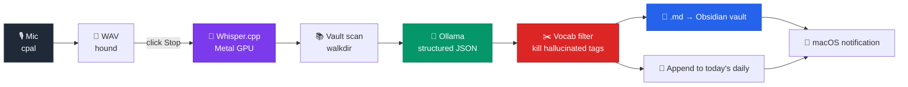

<div align="center">

# `stt-md`

**Record. Transcribe. Summarize. All local. Straight to Obsidian.**

A 3 MB macOS menubar app that turns your meetings into structured Markdown notes — using local Whisper for speech-to-text and a local LLM for summaries — without ever sending audio to the cloud. Works with any Markdown editor; has a deeper integration mode for Obsidian.

[](./LICENSE)
[](https://www.rust-lang.org)
[](https://www.apple.com/macos/)
[](https://developer.apple.com/metal/)
[](#why)
[](#why)

</div>

---

## How it looks

```
┌─ menubar (top-right of macOS) ──────────────────────────────┐
│  ...other icons...   [STT 12:34]   ⏰ 22:47   🔋 87%         │
└───────────────────────────────────────────────────┬─────────┘
                                                    │ click
                                                    ▼
              ┌────────────────────────────────────────────────┐
              │ ● Grabando 12:34 (mic + sistema) · procesando   │
              │   reunión del 10 nov 11:03: transcribiendo 42%  │
              │ Detener — 12:34                          ⌃⌥⌘R  │
              │ ────────────────────────────────────────────── │
              │ Abrir última nota: Seguimiento de desembolsos   │
              │ Notas recientes                              ▸ │
              │ ⚠ Sin procesar (1)                           ▸ │
              │ ────────────────────────────────────────────── │
              │ Resumen                                      ▸ │
              │ Ajustes                                      ▸ │
              │ ────────────────────────────────────────────── │
              │ Salir                                           │
              └────────────────────────────────────────────────┘
```

## Pipeline



## Why

There are great meeting-notes apps already — but most either ship to the cloud, weigh hundreds of megabytes of Electron, or refuse to integrate with the way *you* organize knowledge. `stt-md` is opinionated:

| | Cloud transcribers | [stt-tomi / Meetily](https://github.com/Zackriya-Solutions/meeting-minutes) | **`stt-md`** |
|---|:---:|:---:|:---:|
| Audio leaves your machine | ✅ | ❌ | ❌ |
| Bundle size | ~50–100 MB | ~1.6 GB | **~3 MB** |
| Cold start | varies | 1–2 s | **<500 ms** |
| Backend process | cloud | FastAPI + SQLite | **none (flat files)** |
| UI | Electron / web | Tauri + Next.js | **native AppKit tray** |
| Lines of code | unknown | ~10k+ | **~2k** |
| Output | proprietary | SQLite + JSON | **Markdown into your Obsidian vault** |
| Tag intelligence | none | none | **reuses your existing vault vocabulary** |

The "tag intelligence" piece is the interesting one: most LLM summarizers will happily invent new tags every meeting (`#integration`, `#auth-stuff`, `#team-sync`), polluting your vault with one-off labels. `stt-md` scans your vault first, hands the LLM a closed list of tags you actually use, and *also* filters the LLM's response post-hoc against that list. Hallucinated tags are dropped, not adopted.

## Requirements

- **macOS 11+** on Apple Silicon (uses Metal for Whisper acceleration)
- **[Ollama](https://ollama.ai)** running locally:
  ```bash
  brew install ollama
  ollama pull qwen2.5:7b
  ```
- **A Whisper.cpp GGML model**:
  ```bash
  mkdir -p "$HOME/Library/Application Support/stt-md/models"
  curl -L -o "$HOME/Library/Application Support/stt-md/models/ggml-large-v3-turbo.bin" \
    https://huggingface.co/ggerganov/whisper.cpp/resolve/main/ggml-large-v3-turbo.bin
  ```
- **Rust 1.85+** (only needed to build from source; the crate uses edition 2024)

## Install

### From source

```bash
git clone https://github.com/dreamxist/stt-md
cd stt-md
make build              # cargo build --release + bundle dist/stt-md.app
open dist/stt-md.app    # macOS will ask for mic permission on first launch
```

### Launch at login

```bash
osascript -e 'tell application "System Events" to make login item at end \
  with properties {path:"/full/path/to/stt-md.app", hidden:true}'
```

To remove later:

```bash
osascript -e 'tell application "System Events" to delete login item "stt-md"'
```

## Configuration

On first launch, `~/Library/Application Support/stt-md/config.toml` is created. Two output modes:

### `simple` mode (default for new installs)

Plain Markdown. Just dumps the summary `.md` to a flat folder. **No Obsidian required** — works with any Markdown editor (VS Code, Bear, Logseq, Notion-import, Apple Notes 16+, GitHub gists, …).

```toml
output_mode = "simple"
output_dir = "/Users/<you>/Documents/stt-md-notes"

ollama_model = "qwen2.5:7b"
ollama_url = "http://localhost:11434"
whisper_language = "es"
whisper_model_filename = "ggml-large-v3-turbo.bin"

# Optional: domain vocabulary to bias Whisper's spelling of names/jargon.
# whisper_initial_prompt = "Reunión de MiEmpresa: ProyectoX, Kubernetes, Ana, Joaquín."
```

In simple mode the LLM picks tags freely (max 4, lowercase kebab-case) and there's no daily-note coupling. Output looks like:

```
~/Documents/stt-md-notes/
├── 2026-04-27-1430-team-standup.md
├── 2026-04-27-1605-1on1-juan.md
└── 2026-04-28-0930-planning.md
```

### `obsidian` mode

Full vault integration: scans your vault for tags + wikilinks, writes the meeting note into your vault, and appends a wikilink to today's daily under `## 🤖 Agent Log`.

```toml
output_mode = "obsidian"
vault_root = "/Users/<you>/path/to/your-vault"

ollama_model = "qwen2.5:7b"
ollama_url = "http://localhost:11434"
whisper_language = "es"
whisper_model_filename = "ggml-large-v3-turbo.bin"

# Where meeting notes land and which daily gets the link, relative to the
# vault. Placeholders: {year} {month} {week} (ISO, 2 digits) {date}.
# Defaults shown; adapt to your vault layout:
meetings_dir = "2-calendar/{year}/{month}/meetings"
daily_note = "2-calendar/{year}/{month}/{date}.md"

# Optional: folder whose subfolders (up to 2 levels) are your life/work areas.
# The LLM attributes each meeting to one of them (closed list, hallucinations
# dropped) and it lands as `area:` in the frontmatter.
# areas_dir = "areas"

# Optional: if the daily note doesn't exist yet, create it from this template
# (supports {{date:YYYY-MM-DD}} and {{date:dddd}}) instead of a minimal stub.
# daily_template = "_templates/daily.md"
```

The vault is scanned every time you stop a recording. Hallucinated tags / wikilinks (anything not actually present in the vault) are filtered out post-hoc — the vault is the source of truth, the LLM is treated as untrusted input.

### Meeting reminder (both modes)

If you tend to forget to hit record, stt-md can nudge you: when a meeting app starts using the microphone while stt-md is idle, you get a *"¿Reunión en curso?"* notification. Detection uses CoreAudio process objects (macOS 14+, no extra permissions) against a whitelist of meeting apps — Zoom, Teams, Webex, Slack, Discord, FaceTime, WhatsApp and the major browsers (for Meet & co.). Because it's a whitelist, dictation apps like superwhisper never trigger it.

```toml
meeting_reminder = true   # default; set to false to disable
# Override the built-in whitelist (lowercase bundle-ID prefixes):
# meeting_reminder_apps = ["us.zoom.xos", "com.google.chrome"]
```

It notifies once per meeting and never while already recording. A call is told apart from a voice note by playback: an app that holds the mic *and* plays audio for a few seconds is a call and gets the reminder right away; one that only records (a WhatsApp voice message) has to hold the mic for 45 s first. Short mic drops (<30 s — device switches, reconnects) don't count as a new meeting. On macOS < 14 the detector is silently inactive.

With calendar access granted, the event that is on when you hit record goes along with the recording: the summarizer gets its title as a hint and the note carries it as `event:`.

### Shortcut, CLI and automation

```toml
hotkey = "ctrl+alt+cmd+r"   # default; "" disables it. Read at launch.
```

The shortcut starts and stops a recording from any app. The same thing is available from a terminal — or Raycast, Shortcuts, a Stream Deck — through the app's own binary, which talks to the running instance over a Unix socket:

```bash
/Applications/stt-md.app/Contents/MacOS/stt-md toggle   # or: start | stop
/Applications/stt-md.app/Contents/MacOS/stt-md status   # JSON: recording, queue, stage
/Applications/stt-md.app/Contents/MacOS/stt-md quit     # what was recording stays queued
```

### Stopping and housekeeping

```toml
auto_stop_silence_min = 15   # default; 0 disables it
# keep_recordings_days = 30  # default: keep every WAV forever
```

A recording with no voice on either track for `auto_stop_silence_min` minutes stops by itself and its note is processed; the duration ends at the last voice. A reminder comes first, at 5 minutes. `keep_recordings_days` deletes old WAVs (an hour of meeting is about 500 MB); recordings still waiting to become a note are never deleted.

Edits to `config.toml` apply to the next meeting without relaunching (menu → Ajustes → Editar configuración…). A file that doesn't parse leaves the previous settings in force and says so.

## Usage

1. Press the shortcut, or click `STT` in the menubar → **"Empezar reunión"** (Spanish UI; PRs welcome for translations).
2. Talk. The icon shows `STT 12:34` in real time.
3. Press the shortcut again, or **"Detener"**. The note is made in the background — the menu shows the stage and the percentage — and you can start recording the next meeting right away:
   - Each track is low-passed and resampled to 16 kHz.
   - Whisper transcribes with Metal acceleration, mic and system audio separately.
   - The vault is scanned for existing tags and wikilink targets.
   - The summarizer is asked for a structured JSON summary, with the existing tag vocabulary inserted into the prompt as a closed list.
   - Hallucinated tags / wikilinks are filtered out post-hoc.
4. A new file lands at `<vault>/2-calendar/YYYY/MM/meetings/YYYY-MM-DD-HHMM-<slug>.md`.
5. A line is appended to today's daily under `## 🤖 Agent Log`.
6. macOS notification: *Reunión guardada*, and the note shows up under **"Abrir última nota"**.

Transcribing an hour-long call takes about 4–5 minutes on an M3 Pro.

### Nothing gets lost

Every recording is a small file in `queue/` from its first second until its note exists. If the app crashes, the Mac loses power, or you quit mid-meeting, the next launch finds it and finishes the job (the WAV header is refreshed every 5 s, so at most the last seconds are missing). A meeting that fails to process stays under **"⚠ Sin procesar"** with a retry, and a failed summary still produces a note with the full transcript.

## Output format

<details>
<summary>Click to expand example</summary>

```markdown
---
date: 2026-04-26
day: domingo
time: 14:30
title: Acme standup
duration_min: 32
tags: [meeting, ai-draft, acme]
people: [juan, maria, diego]
project: "[[acme]]"
audio: 2026-04-26-1430-acme-standup.wav
type: meeting
source: stt-md
---

# Acme standup

## Resumen
- Juan finished the onboarding base flow
- Pending validation of final copy with María
- Linear integration prioritized for next sprint

## Decisiones
- Migrar tracking de bugs a Linear esta semana

## Action items
- [ ] @juan — Validar textos finales con María
- [ ] @maria — Avisar al cliente sobre cambio de endpoint *(deadline: 2026-05-05)*

## Personas
- [[juan]]
- [[maria]]
- [[diego]]

## Transcripción
<details>
<summary>Ver transcripción completa</summary>

[00:00] ...
</details>
```

And the day's daily gets:

```markdown
## 🤖 Agent Log

- 14:30 — [[2-calendar/2026/04/meetings/2026-04-26-1430-acme-standup|Acme standup]] (32m) — `stt-md`
```

</details>

## Project layout

```
src/
├── main.rs              # event loop: menu, shortcut, control socket, recording watchdogs
├── app/
│   ├── menu.rs          # the tray menu and what each click means
│   └── icon.rs          # menubar glyph cut out of the app icon
├── lib.rs               # module re-exports
├── pipeline.rs          # recording → note; shared by the app, --selftest and test-e2e
├── jobs.rs              # persistent queue, background worker, crash recovery, retention
├── control.rs           # `stt-md toggle|start|stop|status` over a Unix socket
├── history.rs           # notes written, for "Notas recientes"
├── logging.rs           # timestamped log file when there is no terminal
├── activity.rs          # keeps macOS from napping the app while it works
├── app_state.rs         # enum AppState { Idle, Recording }
├── config.rs            # TOML config in Application Support
├── paths.rs             # filesystem helpers (STT_MD_HOME moves everything)
├── api_key.rs / usage.rs# Gemini key in the Keychain, monthly spend
├── sounds.rs            # afplay wrappers (Tink / Pop)
├── notifications.rs     # notify-rust for macOS notifications
├── meeting_detector.rs  # "¿Reunión en curso?" reminder (CoreAudio process objects)
├── calendar_reminder.rs # "¿Grabo la reunión?" + current event (EventKit)
├── audio_utils.rs       # WAV load, streaming windowed-sinc resampler, dead-air check
├── recording/
│   ├── mic.rs           # cpal stream
│   ├── system_audio.rs  # ScreenCaptureKit system-audio tap (macOS 13+)
│   └── wav_writer.rs    # hound writer on its own thread, flushed every 5 s
├── transcription/
│   └── whisper.rs       # whisper-rs wrapper: windows, progress, hallucination filters
├── llm/
│   ├── gemini.rs        # optional cloud summarizer
│   ├── ollama.rs        # /api/generate with format=json
│   ├── prompts.rs       # structured-summary prompt with vault vocabulary
│   └── mod.rs           # MeetingSummary + enforce_vocab()
├── vault/
│   ├── scanner.rs       # walkdir → tags + wikilink targets (obsidian mode)
│   ├── meeting_writer.rs# generate the .md (obsidian mode)
│   ├── daily_appender.rs# append link to ## 🤖 Agent Log (obsidian mode)
│   └── simple_writer.rs # plain-markdown output (simple mode)
└── bin/
    ├── transcribe-wav.rs # CLI: WAV → bare-transcript .md (no LLM)
    ├── test-summary.rs   # CLI: prompt + Ollama dry run (set STT_MD_VAULT)
    ├── resummarize.rs    # CLI: redo only the summary of an existing note
    └── test-e2e.rs       # CLI: the app's pipeline on existing WAVs, any vault
```

## CLI helpers

```bash
# Just transcribe a WAV (no Ollama, no vault):
./target/release/transcribe-wav path/to/audio.wav title

# Dry-run the prompt + Ollama against your vault:
STT_MD_VAULT="$HOME/path/to/vault" ./target/release/test-summary

# Full pipeline against any vault directory (also how to reprocess an old
# recording: the note lands in the week and daily of the file's timestamp):
./target/release/test-e2e path/to/mic.wav [path/to/sys.wav] path/to/vault

# Run a second copy next to the installed app, with its own config, queue,
# recordings and log (development, experiments):
STT_MD_HOME=/tmp/stt-md-dev ./target/release/stt-md
```

## Design notes

<details>
<summary>Why no Tauri / Electron / webview</summary>

The whole app is a state machine driving a tray icon and a worker thread. There's no UI to render — the only visual is the menubar icon and a context menu. Pulling in a webview would multiply binary size by ~50× for nothing. `tao` + `tray-icon` from the Tauri team give native AppKit menus directly.
</details>

<details>
<summary>Why batch-at-stop instead of streaming VAD</summary>

The reference implementation ([stt-tomi](https://github.com/Zackriya-Solutions/meeting-minutes)) does proper streaming with Silero VAD and incremental Whisper calls during recording. That's a great choice if you want live captions or to reduce the post-stop delay to near-zero. For my use case — meeting ends, drop file in vault, look at it later — batch was simpler and the 30–60 s post-processing is fine. The `processor.rs` slot in the source tree is reserved for a future port of stt-tomi's streaming pipeline.
</details>

<details>
<summary>Why Ollama + the vocab filter</summary>

The naive approach is "ask the LLM to summarize and include some tags." LLMs cheerfully invent tags every time, so over a year you end up with `#integration`, `#integrations`, `#integraciones`, `#integracion`, `#integration-work` all describing the same thing. The fix has two parts:

1. **Constrain the prompt**: scan the vault, extract every tag that already exists in any frontmatter or `#inline` form, and inject that list into the prompt as a closed vocabulary.
2. **Trust but verify**: after the LLM responds, filter `tags` and `project_wikilink` against the vault one more time. The LLM is treated as untrusted input; the vault is the source of truth.

This is a small piece of code (`MeetingSummary::enforce_vocab` in `src/llm/mod.rs`) but it's what makes the output safe to dump into a long-lived knowledge base.
</details>

## Known limitations

- **System audio needs macOS 13+ and Screen Recording permission** (ScreenCaptureKit). Without either, the app records mic-only and says so in the tooltip.
- **Batch at stop**, not streaming — but in the background, so it never blocks the next recording.
- **The mic hears the speakers.** Without headphones the mic track carries a faint copy of the call; exact repeats are dropped as echo, but whisper still invents a line now and then over what is left.
- **No code signing.** macOS will ask "Open Anyway" once per build. For wider distribution you'd need an Apple Developer ID ($99/year).
- **Spanish-Obsidian opinionated.** Menu labels and the prompt template are in Spanish; the output schema assumes a `2-calendar/YYYY/MM/` daily-note vault. Both are easy to adapt — PRs welcome.

## Roadmap

- [x] System audio capture (ScreenCaptureKit, macOS 13+; falls back to mic-only)
- [ ] VAD streaming during recording (port stt-tomi's Silero pipeline)
- [ ] Configurable output schema (multilingual labels, alternative folder layouts)
- [ ] Re-process an existing `.md` (re-run the summarizer with a different model)
- [ ] Code signing + DMG distribution

## Contributing

PRs welcome — especially for translations, alternative vault layouts, or the Whisper streaming port. Open an issue first if it's a non-trivial change so we can align on direction.

## License

[MIT](./LICENSE) — do whatever you want, no warranty.

## Acknowledgements

- [whisper.cpp](https://github.com/ggerganov/whisper.cpp) — local STT
- [Ollama](https://ollama.ai) — local LLM runtime
- [stt-tomi / Meetily](https://github.com/Zackriya-Solutions/meeting-minutes) — the heavyweight cousin this learned from
- [tao](https://github.com/tauri-apps/tao) + [tray-icon](https://github.com/tauri-apps/tray-icon) — native menubar without a webview
